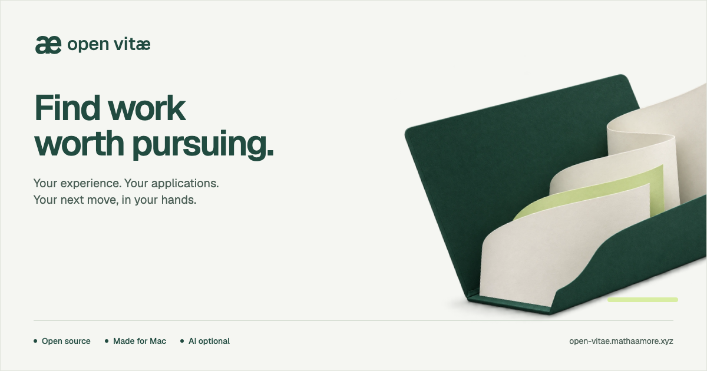

<p align="center">
  <a href="https://open-vitae.mathaamore.xyz/">
    
  </a>
</p>

<h1 align="center">Your job search, in your hands.</h1>

<p align="center">
  An open-source Mac workspace to find roles, prepare honest applications<br>
  and keep track of what happens next. Your files stay on your computer. AI is optional.
</p>

<p align="center">
  <a href="https://github.com/Mathaamore/open-vitae/actions/workflows/checks.yml"></a>
  <a href="LICENSE"></a>
  <a href="macos/README.md"></a>
</p>

<p align="center">
  <a href="https://open-vitae.mathaamore.xyz/">Website</a> ·
  <a href="#get-started">Get started</a> ·
  <a href="#how-its-built">Stack</a> ·
  <a href="docs/ROADMAP.md">Roadmap</a> ·
  <a href="CONTRIBUTING.md">Contribute</a> ·
  <a href="https://github.com/Mathaamore/open-vitae/issues">Issues</a>
</p>

> [!NOTE]
> **Early preview.** The Mac app targets macOS 14+ on Apple Silicon. A verified, notarized public installer is not available yet. You can run the preview from source today.

## Why Open Vitæ?

A job search quickly turns into a collection of browser tabs, CV copies and forgotten follow-ups. Open Vitæ brings the opportunity, your application materials and the next step into one workspace.

Start with your experience. Save a role worth considering. Prepare something you can stand behind. Keep the conversation moving.


*An actual app capture with a fictional profile and jobs.*

## What you can do

| Feature | What you get |
|---|---|
| **Find your next role** | Explore public job feeds selected from your search preferences, follow employer boards, or add a link or description yourself. See the reasons for a match and what still needs checking. |
| **Bring your own CV** | Reuse a one-page PDF as a layout template. Keep the original and generate separate versions for each application. |
| **Prepare in the right language** | Keep explanations in the app language and CVs and answers in the employer’s form language. Override detection when needed. |
| **Follow every application** | Record applications, replies, interviews, offers, rejections and withdrawals, with dated notes and history. |
| **Work offline** | Use your profile, CV imports, saved jobs, drafts and tracker without an account or AI key. Export your data and back up your workspace. |
| **Choose your AI** | Connect ChatGPT, Claude or Gemini, or use a portable prompt with another service. Review every suggestion before using it. |

**You make the final move.** Open Vitæ does not send applications or choose consent and demographic answers for you. Your documented experience remains the source for every draft.

## Get started

### Run the preview

Requires **Python 3.11+**. The bundled Mac application includes its own runtime; these steps are for running from source.

```sh
git clone https://github.com/Mathaamore/open-vitae.git
cd open-vitae
python3 -m venv .venv
.venv/bin/python -m pip install -e '.[test]'
.venv/bin/python -m playwright install chromium --only-shell
.venv/bin/python -m job_agent.main --workspace /tmp/open-vitae-dev
```

Open **http://127.0.0.1:8765**, choose **Get started**, add your profile and save your first offer. You can connect AI later.

`/tmp/open-vitae-dev` is a separate development workspace and may be cleared by the operating system. Choose a persistent directory for your own applications. Without `--workspace`, macOS uses `~/Library/Application Support/Candidatures` (a historical name kept for compatibility); Linux uses `$XDG_DATA_HOME/candidatures` or `~/.local/share/candidatures`.

### Build the Mac app

The native app bundles Python, Codex and Chromium, so end users do not need a terminal. Follow the [Mac build guide](macos/README.md). Local builds are ad-hoc signed; public distribution still requires signing, notarization and clean-Mac verification. See the [release runbook](docs/RELEASING.md).

## Bring your own AI

The core workspace works without AI. Online discovery needs internet; local ranking uses no model tokens.

| Service | How it connects | What to know |
|---|---|---|
| **ChatGPT** | Official local Codex app-server browser sign-in | Your account’s access and usage limits apply. Source builds need the official Codex CLI on `PATH`. |
| **Claude** | Anthropic API key stored in the OS keyring | Separate API billing; a Claude consumer subscription is not connected. |
| **Gemini** | Google AI Studio API key stored in the OS keyring | API project quota or billing; a Gemini consumer subscription is not connected. |
| **Another service** | Copy a portable prompt, then preview and import a JSON result | Review the personal information before sharing. No account connection required. |

Requests use bounded context, a daily request limit and no automatic retries or model upgrades. API providers require a working OS keyring. See [provider behavior and limits](docs/PROVIDERS.md) and [portable AI](docs/PORTABLE_AI.md). Public distribution requirements for the ChatGPT integration still need verification before shipping binaries.

## How it’s built

A Swift Mac shell hosts the interface in WKWebView. A Python service runs on loopback, with SQLite and documents in your local workspace.

| Part | Stack |
|---|---|
| **Mac shell** | Swift · AppKit · WKWebView |
| **Local service** | Python 3.11+ · FastAPI · Uvicorn |
| **Interface** | HTML · CSS · vanilla JavaScript · bundled Geist |
| **Workspace** | SQLite · local document versions and backups |
| **CVs and documents** | ReportLab · pypdf · pdfplumber · standard-library DOCX/TXT parsing |
| **Public form reading** | Playwright · Chromium; no automatic submission |
| **Packaging** | PyInstaller · native Swift shell · Sparkle for release updates |
| **Website** | Static HTML/CSS/JavaScript · Vercel |
| **Checks** | Python unittest · Node test runner · Playwright browser journeys |

Start with the [architecture and code map](docs/ARCHITECTURE.md) to explore the implementation. Node is used for tests; the app and website need no Node runtime or frontend build step. Website deployment settings are in [`site/README.md`](site/README.md).

## A few things to know

<details>
<summary><strong>CV templates, languages and the one-page rule</strong></summary>

Import a **one-page text PDF** to reuse its layout, graphics, text positions, sizes and colors. Standard PDF fonts and embedded TrueType fonts are reused when possible; unsupported fonts or missing glyphs use Geist. Complex or rotated layouts may require a simpler source. Review every export.

DOCX, TXT and multi-page PDFs are text imports. Export a one-page PDF first to reuse their layout. Without a PDF template, Open Vitæ uses its simple layout. Every successful generated CV has exactly one page; an export that would overflow or become illegible fails with an explanation, without silently cutting content.

Explanations use the app language, currently English. CVs and application answers use the detected form language: English, French, German, Spanish, Italian, Dutch or Portuguese. English is the fallback. Change it through **Edit job → Application language**. Integrated or portable AI can translate; offline drafts cannot translate by themselves. Reimport your PDF and prepare a new version to update older drafts.

</details>

<details>
<summary><strong>What stays local, and what leaves your computer?</strong></summary>

Profiles, jobs, SQLite records and documents stay in your selected workspace. Provider credentials use the OS keyring or an isolated Codex session. Disconnecting AI keeps your dossiers. There is no built-in telemetry.

AI requests send relevant context to your chosen provider. Job feeds receive search terms and optional country filtering, not your CV. Employer metadata retrieval is optional; integrated preparation may read public employer pages anonymously. Review portable prompts before sharing them. Keep the local service private; see [SECURITY.md](SECURITY.md).

</details>

<details>
<summary><strong>Job coverage and application limits</strong></summary>

Job sources cover part of the market, and listings can be stale. A match does not establish eligibility. You check facts, review drafts and complete the employer’s application yourself. Dynamic forms may require manual completion; scanned PDFs need OCR elsewhere. See [sources and limits](docs/SOURCES.md).

</details>

## Make it better

Found a confusing screen, an accessibility issue or a reproducible bug? [Open an issue](https://github.com/Mathaamore/open-vitae/issues/new/choose). Want to fix it? Start with the [contributing guide](CONTRIBUTING.md) and [roadmap](docs/ROADMAP.md). Use fictional profiles and jobs in reports, screenshots and tests.

<details>
<summary><strong>Run the checks</strong></summary>

```sh
.venv/bin/python -m unittest discover -s tests -q
node --test tests/test_web.js
.venv/bin/python scripts/check_product_ui.py
.venv/bin/python scripts/check_offline_ui.py
.venv/bin/python scripts/check_landing_ui.py
# After staging, check what Git would publish:
.venv/bin/python scripts/check_repository.py
```

Tests use temporary workspaces and fake providers; no real account or API key is needed. Passing tests do not establish access to every real provider or employer site.

</details>

## License

[MIT](LICENSE) for the original code and project brand assets. Dependencies, fonts and job content retain their own licenses and terms; see [third-party notices](THIRD_PARTY_NOTICES.md). Open Vitæ is an independent project.
