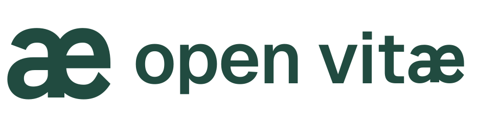
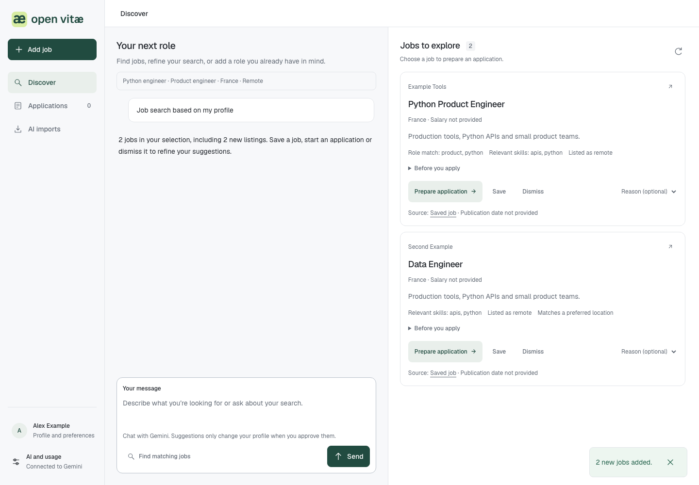

<p align="center"></p>

# Open Vitæ

A local, open-source workspace for finding roles, preparing honest applications and keeping track of what you sent.

**Early preview · MIT · macOS desktop app · French interface**

Introduce yourself, import your CV and explore job suggestions. Keep the offers that interest you; Open Vitæ prepares a company/product/team brief, a CV draft and answers to review and copy to the employer's website. You submit the application yourself and record the outcome.



The app has no paywall or hosted account. AI usage comes from your own provider account or API project and may cost money.

## What it does

- Resumable local onboarding with experience, strengths, motivations and search criteria. Import text PDFs, DOCX or TXT; scanned PDFs need OCR elsewhere.
- Search public feeds from Himalayas and Arbeitnow, plus up to six configured employer boards (Greenhouse, Lever, Ashby), with source attribution and original links.
- Follow source progress, cancel between reads and keep collected offers; [source contracts and limits](docs/SOURCES.md).
- Rank locally and refine suggestions using explicit accept/pass feedback. Search and ranking use no model tokens.
- Discuss criteria with your AI provider. Proposed profile changes require confirmation.
- Queue preparation after accepting an offer. Keep documented CV facts intact and review generated summaries and answers.
- Leave unknown eligibility, missing form questions and consent choices for the candidate to check.
- Save versions, review dossiers and record a submission without requiring a receipt.

## AI providers

| Provider | Access | Cost and limits |
|---|---|---|
| ChatGPT | Official local Codex app-server browser sign-in | Your account's access and usage limits apply |
| Claude | Anthropic API key stored in the OS keyring | API billing; does not connect a Claude subscription |
| Gemini | Google AI Studio API key stored in the OS keyring | Project quota/free tier/billing; does not connect a Gemini subscription |

ChatGPT development uses the official local integration. Registration and distribution requirements must be checked before shipping public binaries. See [provider behavior](docs/PROVIDERS.md).

Default app limit: 20 model requests per UTC day, adjustable from 1 to 100. Failed requests count conservatively. Repeated identical requests can reuse the cache. Context is bounded, requests are serialized and there are no automatic retries or expensive model upgrades. API requests have output-token limits; Codex does not expose a strict per-turn output cap. Only provider-reported token usage is displayed, not an invented credit balance.

## Run from source

Python 3.11+ is required. The service is for local development; the Mac shell bundles the runtime for end users.

```sh
git clone https://github.com/Mathaamore/open-vitae.git
cd open-vitae
python3 -m venv .venv
.venv/bin/python -m pip install -e '.[test]'
.venv/bin/python -m playwright install chromium --only-shell
.venv/bin/python -m job_agent.main
```

Open **http://127.0.0.1:8765**. Connect a provider, complete your profile and search. ChatGPT requires the official Codex CLI on PATH when running from source; Claude and Gemini require a working OS keyring. Tests use fake providers and do not require keys.

The default Mac workspace is `~/Library/Application Support/Candidatures`; the historical directory name is retained for compatibility. On Linux the service uses `$XDG_DATA_HOME/candidatures` or `~/.local/share/candidatures`. To use a separate development space:

```sh
.venv/bin/python -m job_agent.main --workspace /tmp/open-vitae-dev
```

## Mac app

The native AppKit/WKWebView shell targets macOS 14+ on Apple Silicon. It bundles the Python service, Codex and a browser engine; end users do not need a terminal. See [build instructions](macos/README.md) and the [release and recovery runbook](docs/RELEASING.md).

No notarized public installer is published yet. Local builds are ad-hoc signed. Developer ID, Sparkle, notarization and DMG tooling are available in the release-candidate workflow; the signed workflow, real-account access and clean-Mac journey still require verification before publication. Do not bypass macOS security protections to distribute a build.

## Public website

The French static landing page lives in [`site/`](site/README.md). Deploy to Vercel with **Root Directory `site`**, framework **Other**, no build command and output **`.`**. It never connects to the local service. The download CTA remains unavailable until a maintainer records a verified release.

## Privacy

Profiles, SQLite records and generated documents stay in the selected workspace. Requested context is sent to the chosen AI provider; public job feeds receive role/query terms and optional country filtering, not the CV. External employer sites are read anonymously to inspect forms. No telemetry is included.

Provider credentials stay in the OS keyring or isolated Codex session. The app does not copy credentials from another app. Disconnecting a provider does not delete dossiers. The local service must not be exposed publicly; see [SECURITY.md](SECURITY.md).

## Contribute

See [CONTRIBUTING.md](CONTRIBUTING.md) for setup and review expectations, [architecture](docs/ARCHITECTURE.md) for the code map and [roadmap](docs/ROADMAP.md) for current priorities. Small fixes, accessibility improvements and reproducible bug reports are welcome. Use fictional candidate data in every issue, screenshot and test.

```sh
.venv/bin/python -m unittest discover -s tests -q
node --test tests/test_web.js
.venv/bin/python scripts/check_product_ui.py
.venv/bin/python scripts/check_landing_ui.py
# After staging, inspect what Git would publish:
.venv/bin/python scripts/check_repository.py
```

## Limits

The job feeds cover only part of the market and can be stale or unavailable. A match is not proof of eligibility or a job offer. Dynamic forms may need manual completion; the app does not send applications, solve CAPTCHAs or choose consent/demographic answers. The end-to-end tests use fictional providers and jobs; successful tests do not establish access to every real provider account or employer site.

## License

Original code and brand assets are [MIT licensed](LICENSE). Fonts, bundled tools and job content retain their own licenses and terms; see [third-party notices](THIRD_PARTY_NOTICES.md). Open Vitæ is an independent project.
